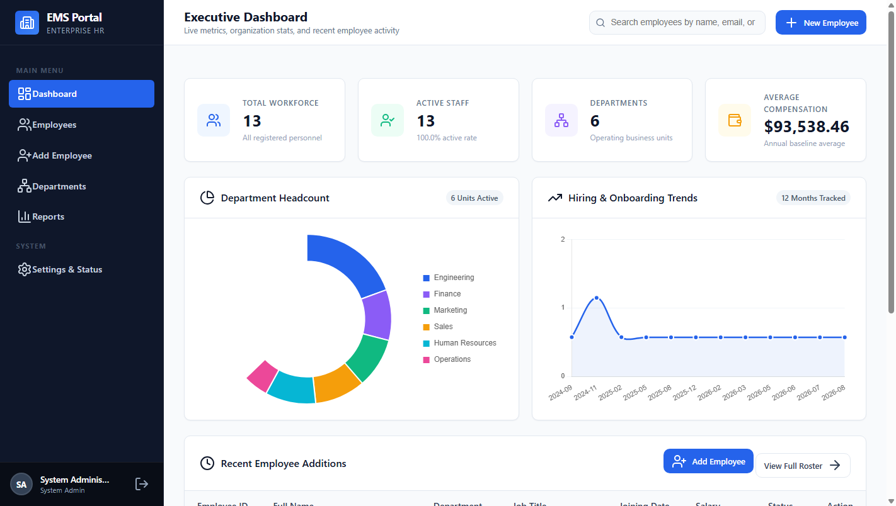
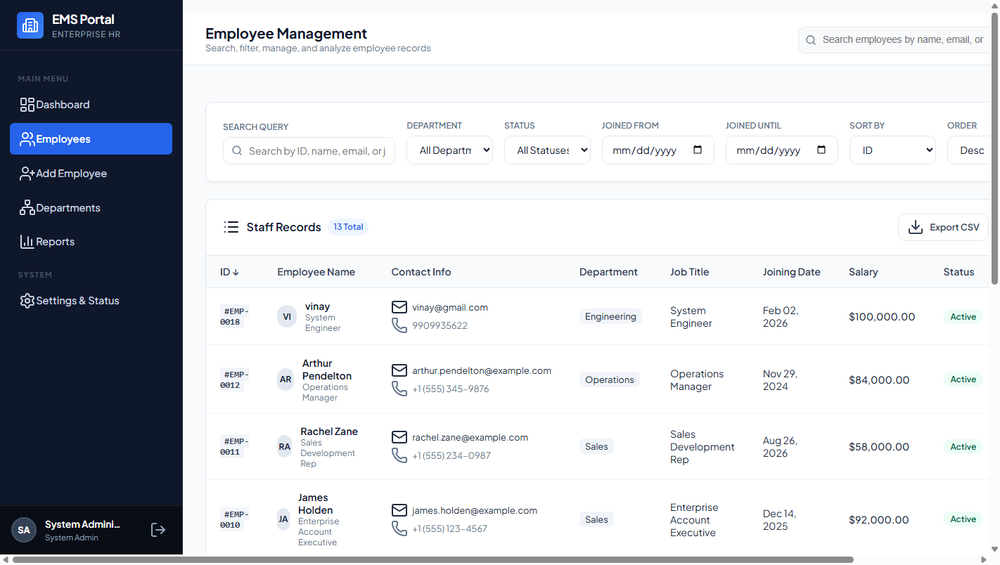
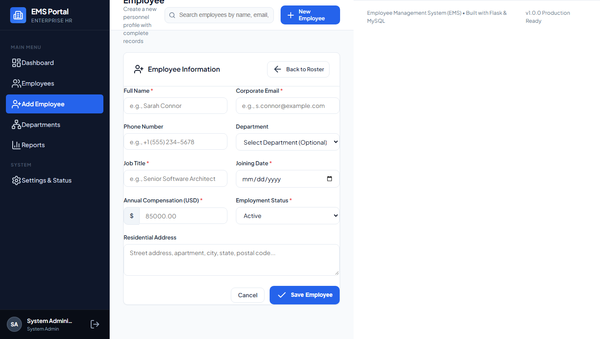
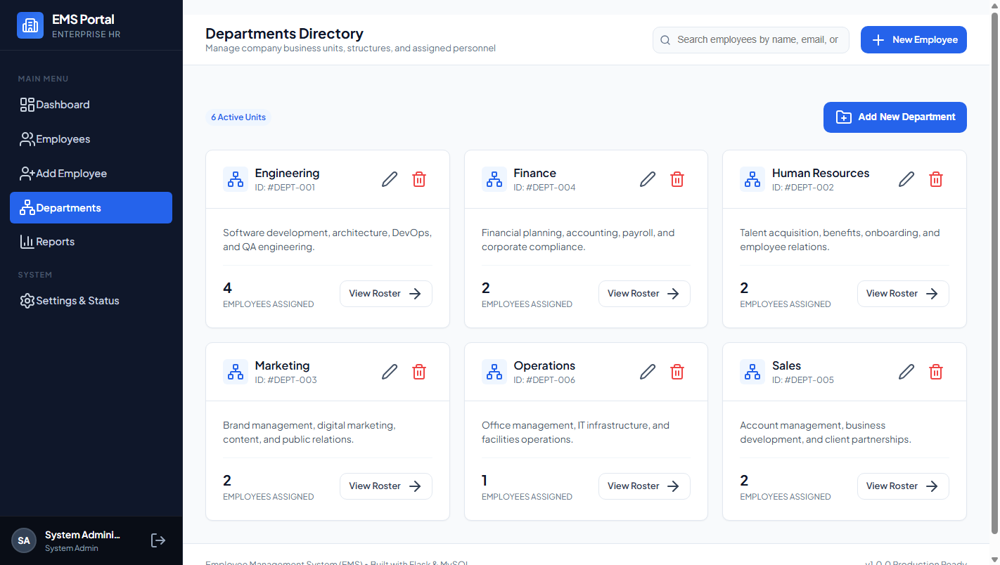
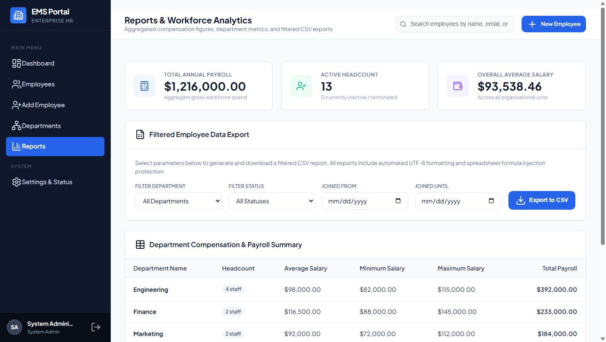

# Employee Management System (EMS)

A complete, production-grade, web-based Employee Management System built with **Python 3**, **Flask**, and **MySQL**, designed for modern HR administration with clean architecture, SaaS-inspired UI/UX, and strict data validation.

---

## Table of Contents

- [Application Preview & Screenshots](#application-preview--screenshots)
- [Key Features](#key-features)
- [Technology Stack](#technology-stack)
- [Portfolio & Architectural Highlights](#portfolio--architectural-highlights)
- [Project Architecture](#project-architecture)
- [Database Schema](#database-schema)
- [Step-by-Step Setup Guide (Clean Environment)](#step-by-step-setup-guide-clean-environment)
  - [1. Prerequisites](#1-prerequisites)
  - [2. Clone the Repository](#2-clone-the-repository)
  - [3. Create and Activate Virtual Environment](#3-create-and-activate-virtual-environment)
  - [4. Install Required Packages](#4-install-required-packages)
  - [5. Setup and Configure MySQL](#5-setup-and-configure-mysql)
  - [6. Configure Environment Variables (.env)](#6-configure-environment-variables-env)
  - [7. Initialize Schema and Secure Admin Setup](#7-initialize-schema-and-secure-admin-setup)
  - [8. Launch the Flask Server](#8-launch-the-flask-server)
  - [9. Access the Application](#9-access-the-application)
- [Running Automated Tests](#running-automated-tests)
- [Deploying to Render with Aiven MySQL](#deploying-to-render-with-aiven-mysql)
  - [1. Setup Managed MySQL on Aiven](#1-setup-managed-mysql-on-aiven)
  - [2. Generate Production Cryptographic Secrets](#2-generate-production-cryptographic-secrets)
  - [3. Create Render Web Service](#3-create-render-web-service)
  - [4. Render Environment Variables Configuration](#4-render-environment-variables-configuration)
  - [5. Initialize Schema & Create Production Administrator](#5-initialize-schema--create-production-administrator)
- [Security and Data Protection](#security-and-data-protection)
- [Troubleshooting Common Issues on Windows](#troubleshooting-common-issues-on-windows)

---

## Application Preview & Screenshots

### 1. Executive Dashboard
Real-time KPI metrics (total workforce, active rate, operating units, average compensation), interactive Chart.js visualizations (department headcount doughnut chart and monthly onboarding line chart), and recent employee additions:



### 2. Employee Management Roster
Server-side search across Employee ID, Full Name, Email, and Job Title; multi-field filtering by Department, Status, and Joining Date range; allowlist-protected sorting and pagination:



### 3. Employee Registration & Edit Form
Comprehensive form with strict server-side validation, duplicate email detection, department selection, salary bounds, date pickers, and user feedback:



### 4. Department Directory & Structure
Business unit directory displaying assigned headcount badges, quick roster view links, department creation/editing modals, and referential deletion protection:



### 5. Workforce Reports & Safe CSV Exports
Company-wide payroll analysis (minimum, maximum, average salary, and total payroll per department) with formula-sanitized CSV export and UTF-8 BOM encoding for Excel compatibility:



---

## Key Features

1. **Executive Dashboard**:
   - Dynamic KPI metric cards: Total workforce, active staff, department count, and average compensation.
   - Interactive **Chart.js** visualizations: Department headcount doughnut chart and 12-month onboarding trends line chart.
   - Recent employee additions table with quick profile navigation.
   - Robust empty-state handling that displays clean guidance rather than errors when the database is empty.

2. **Employee Management (Full CRUD)**:
   - Server-side search across Employee ID, Full Name, Email, and Job Title.
   - Server-side filtering by Department and Status (Active/Inactive).
   - Allowlist-protected sorting by Name, Joining Date, Salary, or ID.
   - Server-side pagination with query parameter retention across pages and filters.
   - Detailed employee profile view with full audit timestamps.
   - Edit employee workflow with form pre-population and duplicate email detection.
   - Deletion with modal confirmation dialog.

3. **Strict Server-Side Validation**:
   - Required field verification, email regex validation, phone format checking, date boundary checks, and non-negative salary constraints.
   - Field-level feedback messages that preserve valid user inputs upon validation failure.

4. **Department Management**:
   - Organization business unit listing with real-time employee counts.
   - Department creation and renaming modals.
   - **Referential Integrity Protection**: Departments with assigned employees cannot be deleted until employees are reassigned or removed.

5. **Workforce Reports & CSV Export**:
   - Department compensation summaries: average salary, minimum, maximum, and total department payroll.
   - Filtered employee data export to CSV with UTF-8 BOM encoding for seamless Microsoft Excel compatibility on Windows.
   - Automatic sanitization against CSV Formula Injection (`=`, `+`, `-`, `@`).

6. **Authentication & Session Security**:
   - Session-based administrator login with scrypt password hashing via Werkzeug.
   - CSRF protection enabled on all state-changing forms using Flask-WTF.
   - Automatic connection teardown preventing dangling MySQL connections.

---

## Technology Stack

- **Backend**: Python 3.12+, Flask 3.0+
- **Database**: MySQL 8.0+ / MariaDB 10.4+
- **Connector**: `mysql-connector-python` with connection pooling
- **Security & Forms**: `Flask-WTF`, `Werkzeug`
- **Frontend**: HTML5, CSS3, Vanilla JavaScript (no heavy frontend frameworks required)
- **Icons**: Lucide Icons (CDN)
- **Visualizations**: Chart.js 4.4+ (CDN)
- **Testing**: `pytest`

---

## Portfolio & Architectural Highlights

This project demonstrates software engineering best practices suitable for modern production environments:

- **Modular Blueprints Architecture**: Strict separation of concerns across functional domains (`auth`, `dashboard`, `employees`, `departments`, `reports`, `settings`).
- **Service Layer Pattern**: Business logic, query construction, and data validation are completely decoupled from HTTP controllers in dedicated service modules (`services/`).
- **Database Connection Pooling**: Built with `mysql.connector.pooling.MySQLConnectionPool` to manage reusable database connections efficiently and eliminate per-request overhead.
- **Teardown App Context Management**: Registered with `app.teardown_appcontext(close_db_connection)` to guarantee automatic closure and zero dangling database connections.
- **Strict SQL Injection Mitigation**: Every SQL statement utilizes parameterized query bindings (`%s`). Dynamic column ordering strictly enforces dictionary allowlists (`ALLOWED_SORT_COLUMNS`, `ALLOWED_SORT_ORDERS`).
- **Robust Multi-Layer Validation**: Server-side validations check email formats, duplicate entries across existing employees, phone numbers, date bounds (1950–2100), and salary ranges before reaching the database.
- **CSV Formula Injection Sanitization**: Neutralizes spreadsheet execution vulnerabilities (`=`, `+`, `-`, `@`, `\t`, `\r`) during data exports.
- **CSRF & Session Hardening**: State-changing POST requests require validated CSRF tokens via `Flask-WTF`; administrative sessions use `HttpOnly`, `SameSite='Lax'`, and password hashing via `scrypt`.
- **Comprehensive Automated Testing**: 56 unit and integration tests executing in under 1 second without external database dependencies through fixtures and mock layers.

---

## Project Architecture

```
employee_management_system/
│
├── app.py                     # Application factory, CLI commands, filter registrations
├── config.py                  # Environment-driven configuration classes
├── db.py                      # Connection pool manager, context managers, health checks
├── schema.sql                 # MySQL schema DDL (departments, employees, admins)
├── seed.py                    # Schema initialization and sample data seeder
├── requirements.txt           # Project package dependencies
├── .env.example               # Template environment configuration file
├── .env                       # Local secrets (ignored by Git)
├── .gitignore                 # Version control exclusions
├── README.md                  # Comprehensive documentation
│
├── routes/                    # Flask Blueprints (Controllers)
│   ├── __init__.py
│   ├── auth.py                # Admin login/logout & @login_required decorator
│   ├── dashboard.py           # Metrics and overview charts
│   ├── employees.py           # Employee CRUD, search, filter, pagination
│   ├── departments.py         # Department management and deletion guard
│   ├── reports.py             # Payroll analytics and CSV download
│   └── settings.py            # System health diagnostics & display options
│
├── services/                  # Business Logic & Database Layer
│   ├── __init__.py
│   ├── auth_service.py        # Password hashing & admin retrieval
│   ├── employee_service.py    # Parameterized SQL queries & validation
│   ├── department_service.py  # Department queries & integrity verification
│   └── report_service.py      # Aggregations, metrics, CSV formula sanitizer
│
├── templates/                 # Jinja2 HTML Templates
│   ├── base.html              # Core SaaS admin panel layout & navigation
│   ├── dashboard.html         # Live KPI dashboard & charts
│   ├── auth/
│   │   └── login.html         # Administrator login form
│   ├── employees/
│   │   ├── list.html          # Paginated roster with search & filters
│   │   ├── add.html           # New employee registration form
│   │   ├── edit.html          # Employee update form
│   │   └── detail.html        # Comprehensive profile card
│   ├── departments/
│   │   └── list.html          # Department cards & management modals
│   ├── reports/
│   │   └── index.html         # Payroll analytics & CSV export tools
│   ├── settings/
│   │   └── index.html         # Diagnostics & preferences
│   └── errors/
│       ├── 404.html           # Not found page
│       ├── 500.html           # Server error page
│       └── db_error.html      # MySQL offline setup guide
│
├── static/                    # Static Assets
│   ├── css/
│   │   └── style.css          # Modern SaaS CSS design system
│   └── js/
│       ├── app.js             # Mobile drawer, modal handling, alerts
│       └── charts.js          # Chart.js initialization
│
└── tests/                     # Automated Test Suite (pytest)
    ├── __init__.py
    ├── conftest.py            # Pytest fixtures and test clients
    ├── test_validation.py     # Validation rules and CSV sanitizer tests
    ├── test_services.py       # Department rules and allowlist tests
    └── test_routes.py         # Route guards and HTTP status code tests
```

---

## Database Schema

```
departments
├── id (INT, PK, AUTO_INCREMENT)
├── name (VARCHAR 100, UNIQUE, NOT NULL)
├── description (VARCHAR 255)
└── created_at (TIMESTAMP)

employees
├── id (INT, PK, AUTO_INCREMENT)
├── full_name (VARCHAR 100, NOT NULL)
├── email (VARCHAR 150, UNIQUE, NOT NULL)
├── phone (VARCHAR 20)
├── department_id (INT, FK -> departments.id, ON DELETE RESTRICT)
├── job_title (VARCHAR 100, NOT NULL)
├── joining_date (DATE, NOT NULL)
├── salary (DECIMAL 12,2, NOT NULL)
├── status (ENUM 'Active', 'Inactive', DEFAULT 'Active')
├── address (VARCHAR 500)
├── created_at (TIMESTAMP)
└── updated_at (TIMESTAMP)

admins
├── id (INT, PK, AUTO_INCREMENT)
├── username (VARCHAR 50, UNIQUE, NOT NULL)
├── email (VARCHAR 150, UNIQUE, NOT NULL)
├── password_hash (VARCHAR 255, NOT NULL)
├── full_name (VARCHAR 100, NOT NULL)
└── created_at (TIMESTAMP)
```

---

## Step-by-Step Setup Guide (Clean Environment)

### 1. Prerequisites
- **Python 3.10+**: Download from [python.org](https://www.python.org/downloads/) (ensure **"Add Python to PATH"** is selected during installation).
- **MySQL Server 8.0+** or **MariaDB 10.4+**:
  - Official **MySQL Community Server**: [mysql.com/downloads/](https://dev.mysql.com/downloads/installer/)
  - Or **XAMPP / MariaDB**: [apachefriends.org](https://www.apachefriends.org/)
- **Git**: [git-scm.com](https://git-scm.com/)

### 2. Clone the Repository
Open PowerShell or your preferred terminal and clone the repository:
```bash
git clone https://github.com/Lakshmana531/employee-management-system.git
cd employee-management-system
```

### 3. Create and Activate a Python Virtual Environment
**On Windows (PowerShell):**
```powershell
python -m venv .venv
.venv\Scripts\Activate.ps1
```
*(If PowerShell displays a script execution policy restriction, run: `Set-ExecutionPolicy -Scope Process -ExecutionPolicy Bypass` then run the activate command again).*

**On macOS / Linux:**
```bash
python3 -m venv .venv
source .venv/bin/activate
```

### 4. Install Required Packages
```bash
python -m pip install --upgrade pip
pip install -r requirements.txt
```

### 5. Setup and Configure MySQL
1. Ensure your MySQL or MariaDB server is active and listening on port `3306` (via Windows Services `services.msc`, MySQL Workbench, or the XAMPP Control Panel).
2. Note your database username (default `root`) and password.

### 6. Configure Environment Variables (.env)
Copy the template configuration file `.env.example` to create your local `.env`:
```powershell
# Windows PowerShell:
Copy-Item .env.example .env

# macOS / Linux:
cp .env.example .env
```

Open `.env` in your editor and adjust your database connection credentials if needed:
```ini
DB_HOST=localhost
DB_PORT=3306
DB_USER=root
DB_PASSWORD=your_actual_mysql_password
DB_NAME=employee_db

SECRET_KEY=enter-a-random-secure-string-here
FLASK_APP=app.py
FLASK_ENV=development
FLASK_DEBUG=1

ITEMS_PER_PAGE=10
CURRENCY_SYMBOL=$
```

### 7. Initialize Schema and Secure Admin Setup

#### Step 7a: Apply Database Schema Tables
Initialize the database tables with foreign keys and performance indexes:
```bash
flask init-db
```

#### Step 7b: Create Your Administrator Account
Create your personal administrator account with secure, masked password input:
```bash
flask create-admin
```
You will be prompted interactively:
```text
Username: admin
Email: admin@example.com
Full name: System Administrator
Password: [Enter your strong password]
Repeat for confirmation: [Confirm your password]
```

#### Step 7c: Seed Starter Business Units & Sample Employees (Optional)
To populate the database with sample departments and realistic employee records for testing:
```bash
python seed.py
```
*(Note: `seed.py` checks existing records and will never overwrite or duplicate existing administrators or departments).*

### 8. Launch the Flask Server
Start the development server:
```bash
python app.py
```
Or via the Flask CLI:
```bash
flask run
```

### 9. Access the Application
Open your web browser and navigate to:
```
http://127.0.0.1:5000
```
Log in using the administrator credentials created in Step 7b.


---

## Running Automated Tests

The application includes comprehensive automated unit and integration tests using `pytest`:

```powershell
python -m pytest tests/ -v
```

All **64 automated unit and integration tests** run in under 2 seconds, validating:

- **Employee CRUD Operations**: Full Create, Read, Update, and Delete endpoints and service operations.
- **Form Data Validation**: Server-side checks for required fields, email format, phone numbers, date boundaries, status enums, non-negative/maximum salary bounds, and text length limits.
- **Duplicate Email Prevention**: Blocks duplicate emails on creation and updates while permitting employees to retain their own email when updating other attributes.
- **Search & Filtering**: Keyword search across name, email, job title, and numeric ID; filtering by department, status, and date range.
- **Missing Records & Error Handling**: Graceful 404 responses for non-existent employee detail and edit views, and safe flash redirects when deleting missing records.
- **Department Management**: Department creation, renaming, and referential deletion protection preventing removal of departments with active staff.
- **Security & Data Protection**: CSV Formula Injection sanitization, sorting allowlist protection, CSRF token verification, and session authentication guards.
- **Dashboard & Analytics**: Dynamic calculations for metrics and Chart.js datasets, with robust empty-database resilience.
- **Production Hardening & Cloud Compatibility**: Enforces strong `SECRET_KEY` in production, rejects insecure fallback placeholders, and sanitizes cloud SQL initialization without requiring root privileges.
- **Flexible Database Connectivity**: Supports standard discrete credentials as well as single cloud connection strings (`DATABASE_URL` / `MYSQL_URL`).


---

## Deploying to Render with Aiven MySQL

This guide provides end-to-end instructions for deploying the Employee Management System to **Render** using a managed **Aiven MySQL** cloud database.

```
┌──────────────────────────────────────┐          TLS / SSL          ┌───────────────────────────────────┐
│        Render Web Service            │ ──────────────────────────> │         Aiven Cloud MySQL         │
│  - Linux Container                   │       Port: 12345+          │  - Managed MySQL 8.0              │
│  - Gunicorn WSGI Server              │                             │  - Pre-created 'defaultdb'        │
│  - ProductionConfig Hardening        │                             │  - Automated backups & failover   │
└──────────────────────────────────────┘                             └───────────────────────────────────┘
```

### 1. Setup Managed MySQL on Aiven

1. Log into your [Aiven Console](https://console.aiven.io/).
2. Click **Create Service** and select **MySQL** (Free tier or Developer plan).
3. Select your cloud provider and region (preferably matching your Render region, e.g., Frankfurt or Oregon).
4. Name your service (e.g., `ems-mysql`) and click **Create Service**.
5. Once active (status turns green), open the **Overview** tab:
   - Note the **Host**, **Port**, **User** (`avnadmin`), **Password**, and **Database Name** (`defaultdb`).
   - (Optional) In the **Connection information** panel, download `ca.pem` if you wish to enforce custom CA certificate verification.

### 2. Generate Production Cryptographic Secrets

Generate a cryptographically strong 64-character hexadecimal `SECRET_KEY` on your local terminal:

```bash
python -c "import secrets; print(secrets.token_hex(32))"
```

> [!IMPORTANT]
> The application will refuse to start in `FLASK_ENV=production` if `SECRET_KEY` is missing, shorter than 16 characters, or set to a development fallback placeholder.

### 3. Create Render Web Service

1. Log into [Render Dashboard](https://dashboard.render.com/).
2. Click **New +** -> **Web Service**.
3. Connect your GitHub repository: `https://github.com/Lakshmana531/employee-management-system`.
4. Configure service settings:
   - **Name**: `employee-management-system`
   - **Region**: Choose the region closest to your Aiven MySQL database.
   - **Branch**: `main`
   - **Root Directory**: Leave blank (uses repository root).
   - **Runtime**: `Python 3`
   - **Build Command**: `pip install -r requirements.txt`
   - **Start Command**: `gunicorn app:app` (Render also detects this from the included `Procfile`).

### 4. Render Environment Variables Configuration

In your Render Web Service dashboard, navigate to the **Environment** tab and add the following variables:

| Variable Name | Required | Example / Recommended Value | Purpose |
|---|:---:|---|---|
| `FLASK_ENV` | **Yes** | `production` | Activates production hardening, secure cookies, and disables debug mode |
| `SECRET_KEY` | **Yes** | `4f8c92a1e7...` *(64 hex characters)* | Cryptographic key for session signing and CSRF protection |
| `DB_HOST` | **Yes** | `mysql-xxxx-project.aivencloud.com` | Hostname of your Aiven MySQL cluster |
| `DB_PORT` | **Yes** | `12345` | Port provided in Aiven console |
| `DB_USER` | **Yes** | `avnadmin` | Tenant MySQL user provided by Aiven |
| `DB_PASSWORD` | **Yes** | `AVNS_...` | Database password provided by Aiven |
| `DB_NAME` | **Yes** | `defaultdb` | Pre-created database name in Aiven |
| `DB_SSL_DISABLED` | No | `false` | Ensures SSL/TLS encryption is enabled |
| `ADMIN_USERNAME` | No | `admin` | Username for automated admin account creation |
| `ADMIN_PASSWORD` | No | `YourStrongAdminPassword!` | Password for automated admin account creation |
| `ADMIN_EMAIL` | No | `admin@yourdomain.com` | Email for administrator account |

*(Optional SSL CA Certificate)*: If you want certificate authority verification, add your downloaded `ca.pem` as a **Secret File** in Render at `/etc/secrets/ca.pem` and set `DB_SSL_CA=/etc/secrets/ca.pem`.

### 5. Initialize Schema & Create Production Administrator

Once Render deploys your service, initialize the schema tables:

#### Option A: Using the Render Web Shell (Recommended)
1. Go to your Render Web Service dashboard.
2. Click **Shell** in the left sidebar.
3. Apply the database schema:
   ```bash
   flask init-db
   ```
   *(This creates all tables, foreign keys, and indexes using `CREATE TABLE IF NOT EXISTS` without requiring MySQL root privileges).*
4. Create your administrator account interactively:
   ```bash
   flask create-admin
   ```
   Follow the prompts to enter your username, email, full name, and password with masked input.

#### Option B: Automatic Seeding during Build
Alternatively, you can append database initialization to Render's Build Command:
```bash
pip install -r requirements.txt && python seed.py --admin-only
```
*(When `ADMIN_USERNAME` and `ADMIN_PASSWORD` are defined in Render's Environment variables, `seed.py` creates the administrator account safely and idempotently without overwriting existing data).*

### 6. Verify Deployment

1. Review Render's runtime logs to confirm:
   ```text
   [INFO] MySQL connection pool 'ems_pool' initialized.
   [INFO] Starting gunicorn 21.2.0
   [INFO] Listening at: http://0.0.0.0:10000
   ```
2. Open your live Render URL (e.g., `https://employee-management-system.onrender.com`).
3. Log in with your production administrator credentials.
4. Verify the Executive Dashboard KPI metrics, Chart.js visualizations, and Employee Management roster.


## Security and Data Protection

- **Parameterized Queries**: All database queries use parameterized placeholders (`%s`) to prevent SQL Injection.
- **Sorting Allowlist**: Sorting columns and directions are validated against strict Python allowlists before constructing queries.
- **CSRF Tokens**: All state-changing forms (`POST`) require valid CSRF tokens provided by `Flask-WTF`.
- **Password Hashing**: Passwords are never stored in plaintext; they are hashed using Werkzeug's `scrypt` implementation.
- **Session Protection**: Cookies are configured with `HttpOnly` and `SameSite='Lax'` flags.
- **CSV Formula Sanitization**: Prepends single quotes to user-controlled values starting with `=`, `+`, `-`, or `@` to neutralize spreadsheet execution vulnerabilities.

---

## Troubleshooting Common Issues on Windows

### 1. PowerShell Script Execution Policy Error
**Symptom**: `.venv\Scripts\Activate.ps1 cannot be loaded because running scripts is disabled on this system.`
**Solution**: Run this command in PowerShell to permit script activation for the current session:
```powershell
Set-ExecutionPolicy -Scope Process -ExecutionPolicy Bypass
.venv\Scripts\Activate.ps1
```

### 2. MySQL Connection Refused (Error 2003 / 10061)
**Symptom**: `Can't connect to MySQL server on 'localhost:3306' (10061)`
**Solution**:
1. Check that MySQL service is running:
   - Press `Win + R`, type `services.msc`, and look for `MySQL` or `MySQL80`. Click **Start**.
   - If using XAMPP, open the XAMPP Control Panel and click **Start** next to MySQL.
2. Verify that port 3306 is not blocked by Windows Firewall or another application.

### 3. Access Denied for User 'root'@'localhost' (Error 1045)
**Symptom**: `Access denied for user 'root'@'localhost' (using password: YES)`
**Solution**:
1. Open `.env` and verify that `DB_PASSWORD` matches the password set when MySQL was installed.
2. If your local MySQL `root` account has no password, set `DB_PASSWORD=` (leave it blank).

### 4. Port 5000 is Already in Use
**Symptom**: `OSError: [WinError 10048] Only one usage of each socket address is normally permitted`
**Solution**: Launch the Flask application on an alternative port:
```powershell
$env:PORT="5001"
python app.py
```
Then visit `http://127.0.0.1:5001`.

---

## Portfolio & Demonstration Checklist

- [x] Full End-to-End Application (No static mockups).
- [x] Real MySQL Schema with Foreign Keys, Constraints, and Indexes.
- [x] Connection Pooling and Context Managers.
- [x] Clean Service-Oriented Backend Architecture.
- [x] Responsive SaaS Dashboard with Chart.js.
- [x] Full CRUD on Employees with Server-Side Search, Filter, Sort, & Pagination.
- [x] Department Management with Business Rule Protection against Orphaned Records.
- [x] CSV Reporting with Formula Injection Sanitization.
- [x] Automated Test Suite passing 100% of tests.
